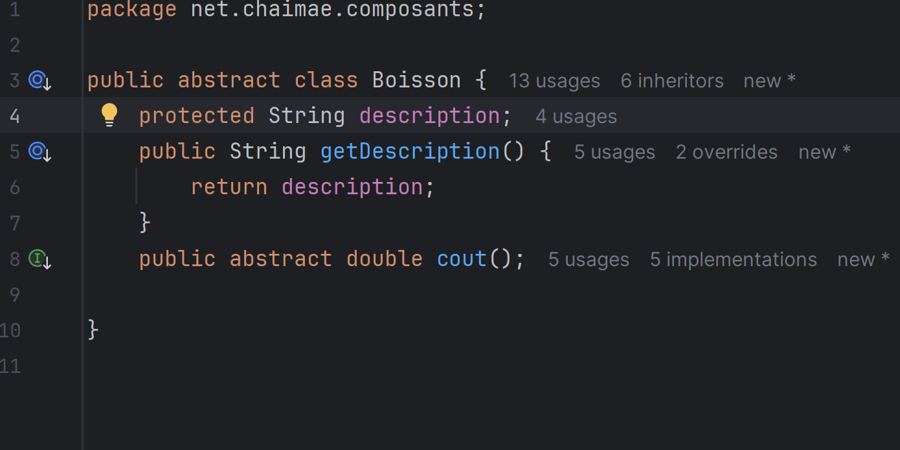
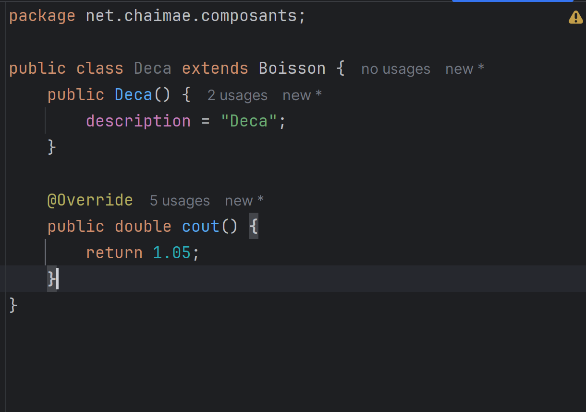
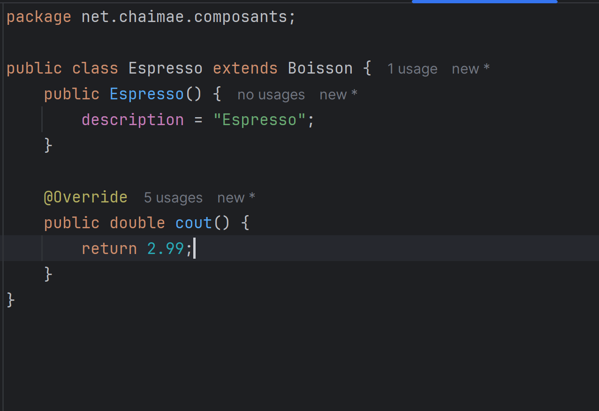
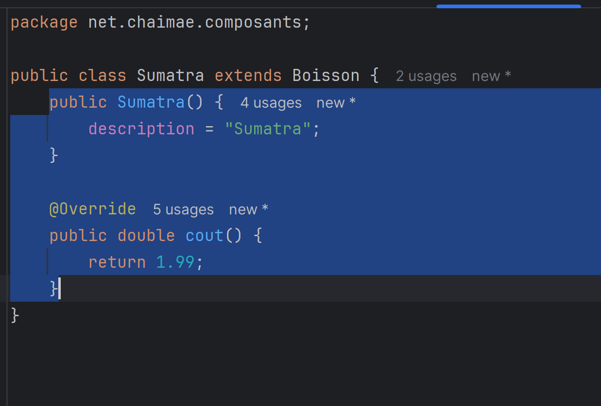
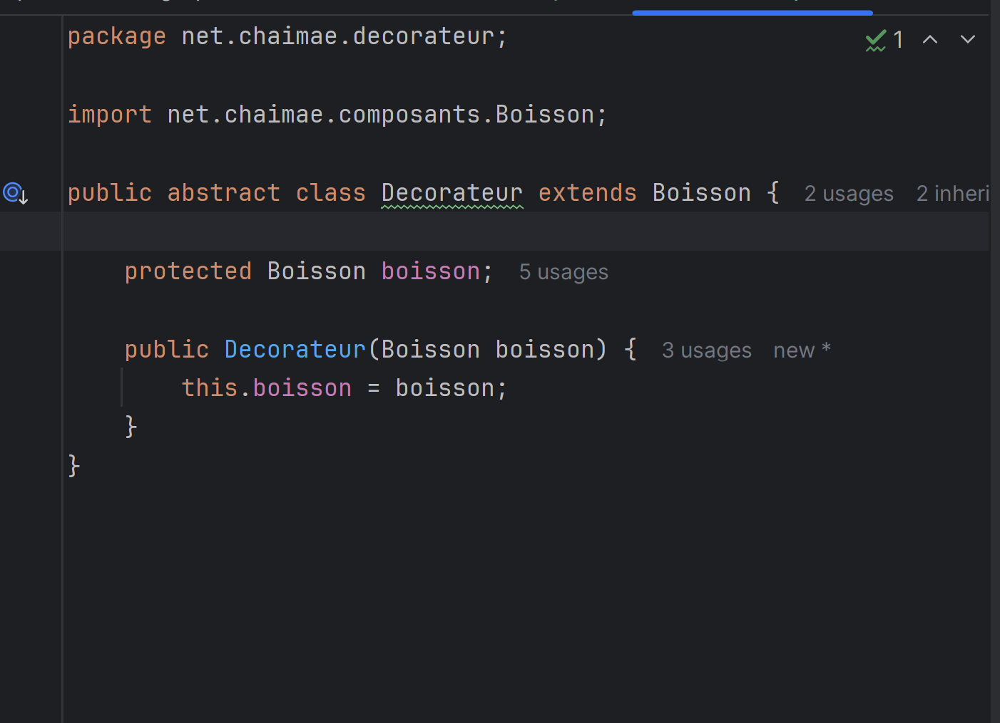
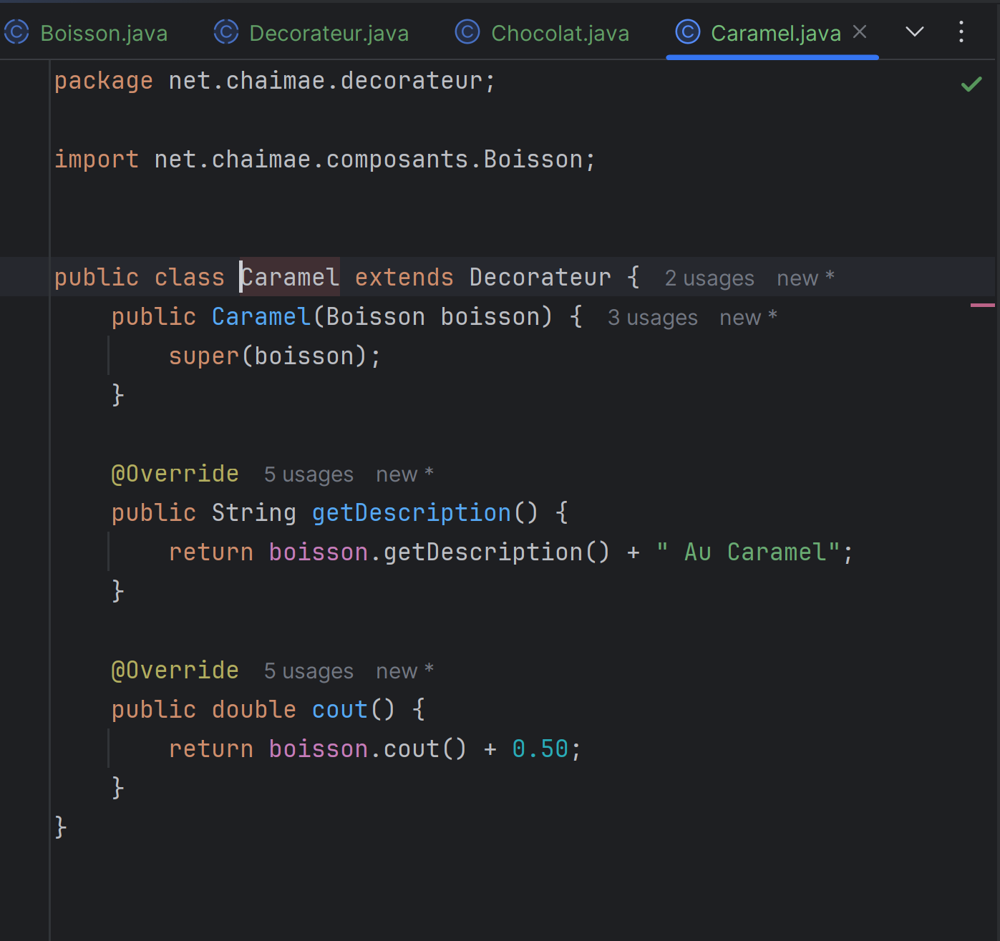
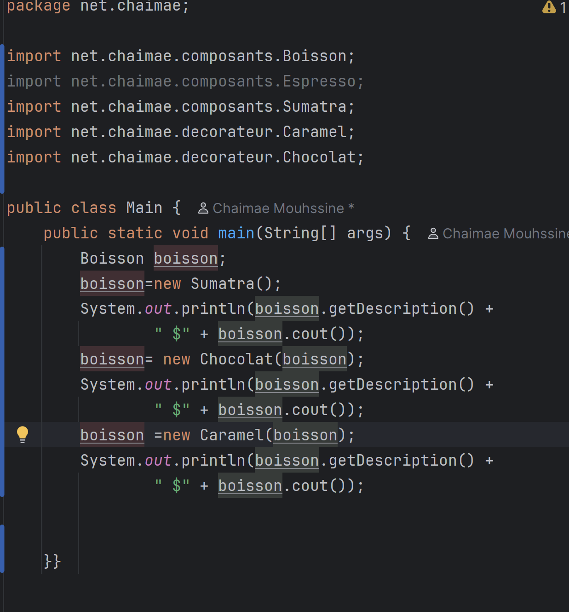
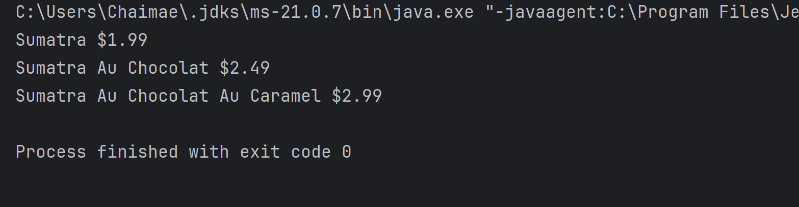
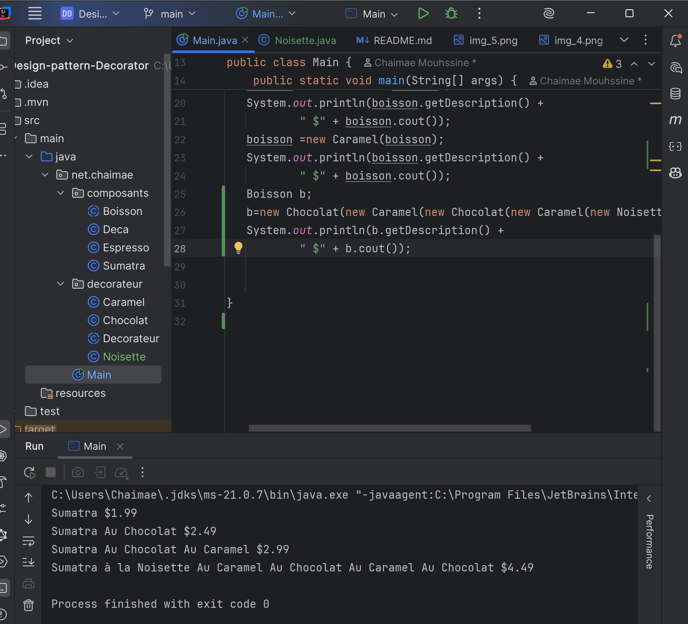

# Design-Patter-Decorator
La class Boisson est la classe de base pour toutes les boissons. Elle contient une méthode getDescription() qui retourne la description de la boisson et une méthode cost() qui retourne le coût de la boisson.

La class Deca est une sous-classe de Boisson qui représente une boisson décaféinée. Elle surcharge la méthode getDescription() pour retourner "Deca" et la méthode cost() pour retourner le coût de la boisson décaféinée.

La class Espresso est une sous-classe de Boisson qui représente un espresso. Elle surcharge la méthode getDescription() pour retourner "Espresso" et la méthode cost() pour retourner le coût de l'espresso.

La class Sumattra est une sous-classe de Boisson qui représente un café Sumatra. Elle surcharge la méthode getDescription() pour retourner "Sumatra" et la méthode cost() pour retourner le coût du café Sumatra.

La class Decorateur est une classe abstraite qui étend la classe Boisson. Elle contient une référence à un objet Boisson et surcharge la méthode getDescription() pour retourner la description de la boisson décorée.

La class Caramel est une sous-classe de Decorateur qui représente un décorateur de caramel. Elle surcharge la méthode getDescription() pour retourner la description de la boisson décorée avec "Caramel" et la méthode cost() pour retourner le coût de la boisson décorée avec le coût du caramel.

# l'éxecution

